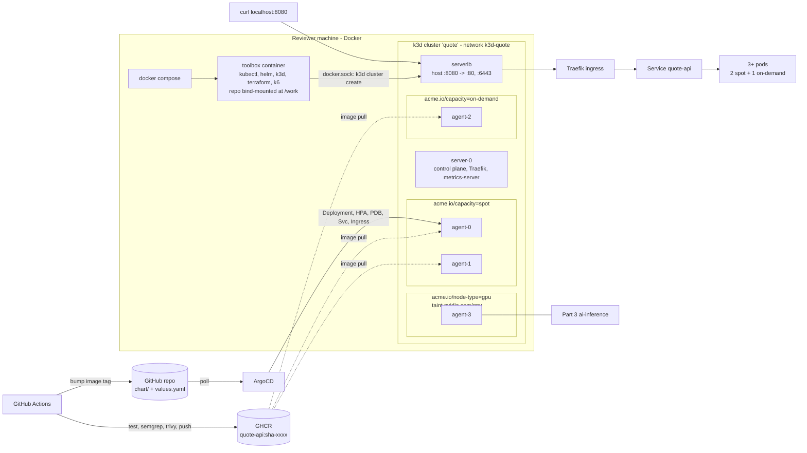

# quote-api: DevOps take-home

A small Go API, shipped to GHCR by GitHub Actions and deployed by ArgoCD onto a local 4-agent k3d cluster
that simulates spot / on-demand / GPU nodepools.

## Quick start

You must have Docker with Compose v2. You must have 6 GB of free memory.

```bash
git clone <this-repo> && cd <this-repo>
docker compose up -d        # builds the toolbox, creates the k3d cluster, runs troubleshoot/prepare.sh
./scripts/run-all.sh        # runs all task scripts in sequence, then does a curl from the host
curl http://localhost:8080/api/quote
./scripts/99-teardown.sh    # removes the cluster and the toolbox
```

You can start the scripts from the host. Each script then runs itself in the toolbox with `docker compose exec`.
You can also start the scripts in the toolbox shell (`docker compose exec toolbox bash`).

## Architecture



The toolbox drives the host's Docker daemon through the socket, so the k3d nodes are sibling containers
(nothing nested). Both share the `k3d-quote` network, so kubectl inside the toolbox talks to `k3d-quote-serverlb:6443` by name.

## Script reference

| Script | What it does | When |
|---|---|---|
| `00-cluster.sh` | Creates k3d (1 server + 4 agents, k3s v1.36), writes the kubeconfig, runs `troubleshoot/prepare.sh`, makes Traefik HA | automatically on `docker compose up`; safe to re-run |
| `20-deploy.sh` | Installs ArgoCD (Helm), applies the `Application` pointing at this repo's `chart/`, waits for Healthy, curls the ingress | after bootstrap |
| `25-reclaim-drill.sh` | Drains a spot node running the app while a curl loop hits the ingress, shows pods moving, uncordons; fails on any non-200 or if no replica stays on on-demand | after 20 |
| `30-troubleshoot.sh` | Applies `broken-app.yaml` (fresh cluster only), then `fixed-app.yaml`, then runs `troubleshoot/verify.sh` | any time after bootstrap |
| `50-validate-tf.sh` | `terraform fmt -check`, `init -backend=false`, `validate` on `terraform/` (Cloudflare) | any time |
| `51-validate-karpenter.sh` | Installs Karpenter v1 CRDs (no controller) and server-side dry-runs `karpenter/` | after bootstrap |
| `run-all.sh` | All of the above in order + a curl from the host | after `docker compose up -d` |
| `99-teardown.sh` | Deletes the cluster, then `docker compose down` | when done |

## Repo map

`app/` Go service + Dockerfile · `chart/` Helm chart · `argocd/` Application · `cluster/` cluster add-on config · `troubleshoot/` Part 3 (provided + `fixed-app.yaml`) ·
`.github/workflows/ci.yml` Part 4 · `terraform/` Part 5b · `karpenter/` Part 5a ·
[TROUBLESHOOTING.md](TROUBLESHOOTING.md) · [MIGRATION-NOTES.md](MIGRATION-NOTES.md) · [OPS-ANSWERS.md](OPS-ANSWERS.md) · [AI-USAGE.md](AI-USAGE.md)

## Design decisions & trade-offs

- **Go, standard library only.** ~150 lines; static binary on distroless `nonroot` (~16 MB image), no dependency tree to scan or patch. The Prometheus counter is hand-written text format; a client library would be the choice past a handful of metrics.
- **CPU work is a wall-clock busy loop** (100 ms of SHA-256), so every request costs real CPU and the HPA has something to react to.
- **Graceful shutdown:** on SIGTERM the app fails `/readyz`, waits 5 s for endpoints/Traefik to drop it, then drains. That's what makes the reclaim drill show zero failed requests rather than a few 502s.
- **Placement = one Deployment, three rules:**
  required affinity `acme.io/capacity in (spot, on-demand)` (never the GPU node or the k3s server) ·
  preferred affinity to spot (weight 100) ·
  **hard** topology spread on `acme.io/capacity` with `maxSkew: 1` → at 3 replicas the second pod *must* go to on-demand, giving 2 spot + 1 on-demand ·
  **soft** spread on hostname so a drain can double up on the surviving spot node.
  `nodeTaintsPolicy: Honor` drops cordoned nodes from the skew count, so the hard rule doesn't deadlock during a drain; `matchLabelKeys: [pod-template-hash]` makes each rollout lay out its own pods cleanly.
- **Known limits of that placement:** (1) scaling out keeps spot/on-demand balanced (10 replicas → 5/5), so cost stays high under load; `maxSkew: 2` would allow spot-heavier layouts. (2) Spread is only enforced at scheduling: a scale-down can remove the on-demand pod. A descheduler (`RemovePodsViolatingTopologySpreadConstraint`), or a separate 1-replica Deployment pinned to on-demand, closes that; both are more moving parts than this exercise needs.
- **No `replicas` in the Deployment:** the HPA owns it, so ArgoCD's self-heal doesn't fight the autoscaler.
- **GitOps image flow:** CI pushes `sha-<short>` and commits that tag into `chart/values.yaml` (`[skip ci]`). The Application tracks the branch, so a deploy is a git commit and a rollback is a revert. ArgoCD Image Updater would remove the bot commit; skipped as one more controller.
- **The Application's repo URL is taken from the clone's `origin`**, so a fork deploys its own chart without edits (override with `REPO_URL=`).
- **Ingress HA (found by the drill):** k3s ships Traefik as 1 replica with no PDB. When the drill drained the spot node that hosted Traefik, every request failed. `cluster/traefik-ha.yaml` (a k3s HelmChartConfig) sets 2 replicas on different hosts, a PDB with `minAvailable: 1`, and a 5 s accept grace on shutdown. The drill now passes when it drains a Traefik node.
- **Toolbox is built locally by compose**, not pulled: one less image to publish and version. The cost is a first build of about 1 min.
- **Toolbox size:** multi-stage build. A Debian stage downloads each tool and checks its sha256. The final `debian:trixie-slim` stage gets only the binaries plus `curl`. No git (the deploy script reads `.git/config` directly) and no jq. Image content went from 543 MB to 448 MB (compressed pull 178 MB to 148 MB); the rest is the required binaries. UPX would halve that but adds decompression on every `kubectl`/`terraform` call, so it was rejected.
- **No Alpine anywhere I control:** musl's resolver acts differently from glibc in Kubernetes DNS. The app runs on `distroless/static-debian13`; build stages and the toolbox use Debian trixie.
- **Cut:** observability stack (Part 6 not chosen), cosign signing, OpenTelemetry tracing, AWS production diagram, ArgoCD UI exposure (`kubectl -n argocd get applications` shows the state).

## Issues found in the provided files

- **The k3s server node is schedulable and unlabeled.** `prepare.sh` correctly skips control-plane nodes, so anything without constraints can land on the server. The chart's required affinity on `acme.io/capacity` keeps the app on the labeled pools; I chose that over tainting the server so the fix lives in my workload, not the node layout.
- **`verify.sh` 60 s rollout timeout** can fail on a cold image pull; `30-troubleshoot.sh` waits up to 300 s first. Provided files are unmodified.
- **`ci/legacy.gitlab-ci.yml` contains AWS keys** (AWS's documentation examples). Kept as provided since it is the input to Part 4; nothing in the new pipeline carries them over.

## Troubleshooting on the reviewer's machine

- **Port 8080 is in use.**
  1. Run `./scripts/99-teardown.sh` if a cluster exists. The cluster keeps the port that it got at creation.
  2. Run `HOST_PORT=18080 docker compose up -d`.
  3. Run `HOST_PORT=18080 ./scripts/run-all.sh`.
- **Pods stay Pending, or the system is slow.** The 5 k3s nodes and ArgoCD use 4 to 6 GB of memory.
  1. On Docker Desktop, open Settings > Resources.
  2. Increase the memory to a minimum of 6 GB.
- **The Docker socket is not at `/var/run/docker.sock`** (rootless Docker, Colima or Podman).
  1. In `docker-compose.yml`, change the socket volume to the path of your socket. For example: `~/.colima/default/docker.sock`.
- **Apple Silicon.** No action is necessary. The toolbox builds for the host architecture and the app image is multi-arch.
- **The bootstrap failed.**
  1. Run `docker compose logs toolbox` and read the error.
  2. Run `./scripts/00-cluster.sh` to try the bootstrap again.
